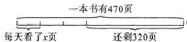

# Mathematics (Grade 5)

**ID**: f6fed601
**难度**: medium
**题型**: short_answer

## 题目
看图列方程并求解。

## 解答

**答案**: 50

1. Step1:根据图形可知等量关系式为每天看的页数×3＋还剩的页数＝一本书的页数
2. Step2:设每天看了x页，根据上述等量关系列出方程3x＋320＝470
3. Step3:求解方程，先将320移到等号右边，得到3x＝470 - 320
4. Step4:计算470 - 320 = 150，即3x = 150
5. Step5:方程两边同时除以3，得到x = 150÷3
6. Step6:计算150÷3 = 50，得出x = 50

## 知识点

**知识点**:
  - 小学数学;数与代数;式与方程;列方程解含一个未知数的问题;应用题;常见的数学问题;图文问题

---
