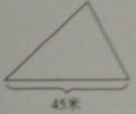

# Mathematics (Grade 5)

**ID**: f83063ff
**难度**: medium
**题型**: short_answer

## 题目
李大爷家有一块三角形苗圃（如图），底边长45米，是高的1.5倍，今年卖树苗共获利4050元，平均每平方米获利多少元？

 45米

## 解答

**答案**: 6

1. Step1:根据底边长是高的1.5倍，求出高为45÷1.5 = 30米
2. Step2:根据三角形面积公式底×高÷2，计算出三角形苗圃的面积为45×30÷2 = 675平方米
3. Step3:用总获利金额除以面积，得到平均每平方米获利为4050÷675 = 6元

## 知识点

**知识点**:
  - --

---
