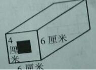

# Mathematics (Grade 5)

**ID**: f8ec7994
**难度**: medium
**题型**: short_answer

## 题目
下面长方体是空心的,已知实心部分的体积是160立方厘米,求这个长方体的长是多少厘米？

 4厘米,6厘米,6厘米

## 解答

**答案**: 8

1. Step1:计算空心部分的截面积为4×4 = 16平方厘米
2. Step2:计算整个长方体底面的截面积为6×6 = 36平方厘米
3. Step3:计算实心部分的截面积为36 - 16 = 20平方厘米
4. Step4:用实心部分的体积160立方厘米除以实心部分的截面积20平方厘米，即160÷20 = 8厘米，得到长方体的长

## 知识点

**知识点**:
  - 

---
