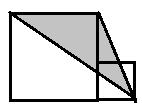

# Mathematics (Grade 5)

**ID**: fa40dd59
**难度**: medium
**题型**: short_answer

## 题目
下图由两个正方形组成，大正方形边长10厘米，小正方形边长6厘米，计算阴影部分的面积 .

## 解答

**答案**: 50

1. Step1:明确阴影部分为三角形
2. Step2:确定阴影三角形的底为大正方形的边长，即10厘米
3. Step3:确定阴影三角形的高为大正方形的边长，即10厘米
4. Step4:根据三角形面积公式S = 底×高÷2，计算面积为10×10÷2
5. Step5:计算10×10÷2 = 100÷2 = 50平方厘米
6. Step6:得出阴影部分面积为50平方厘米

## 知识点

**知识点**:
  - --

---
