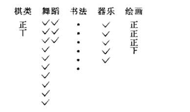

# Mathematics (Grade 6)

**ID**: 01783612
**难度**: hard
**题型**: fill_in_the_blank

## 题目
下面是二年级同学统计参加兴趣小组的情况 

（1）把上面统计的结果填入下表。
$\begin{array}{|c|c|c|c|c|c|}
\hline
运动项目
 & 棋类
 & 舞蹈
 & 书法
 & 器乐
 & 绘画
 \\\hline
人数
 &  
 &  
 &  
 &  
 &  
 \\\hline
\end{array}$
（2）参加书法兴趣小组和参加绘画兴趣小组的一共有________人。
（3）参加舞蹈兴趣小组的人数比参加器乐的人数多________人。
（4）你最喜欢的项目是________。

## 解答

**答案**: 7, 13, 6, 5, 18, 24, 8, 绘画

1. Step1:数出棋类的“正”字笔画数，一“正”字是5笔，“正丅”共7笔，所以棋类人数为7人
2. Step2:数出舞蹈的“√”个数，共13个，所以舞蹈人数为13人
3. Step3:数出书法的“·”个数，共6个，所以书法人数为6人
4. Step4:数出器乐的“√”个数，共5个，所以器乐人数为5人
5. Step5:数出绘画的“正”字个数和笔画数，3个“正”字加3笔，3×5 + 3 = 18，所以绘画人数为18人
6. Step6:计算参加书法兴趣小组和参加绘画兴趣小组的总人数，6 + 18 = 24人
7. Step7:计算参加舞蹈兴趣小组的人数比参加器乐的人数多的人数，13 - 5 = 8人
8. Step8:按题目要求写出自己最喜欢的项目为绘画

## 知识点

**知识点**:
  - 

---
