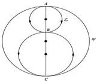

# Mathematics (Grade 6)

**ID**: 02176597
**难度**: hard
**题型**: fill_in_the_blank

## 题目
如图，甲、乙两只蚂蚁在下列圆周上运动．AC为大圆的直径，点B在AC上，AB、BC分别为两个小圆的直径．甲蚂蚁在大圆上顺时针爬行，乙蚂蚁在两个小圆上沿着箭头所指方向绕“8”字爬行（A→B→C→B→A）．甲蚂蚁与乙蚂蚁在某一时刻同时从A点出发，然后不断爬行，速度为V甲：V乙=3：2．经过T1分钟，两只蚂蚁相遇．接下来，甲蚂蚁将自己的速度提高了$\frac{1}{3}$，乙蚂蚁的速度不变，继续在原来的轨道上爬行．经过T2分钟，两只蚂蚁再一次相遇．已知T1+T2=1003-993+983-983+…+23-13，则甲蚂蚁按原来的速度绕大圈爬行一周需要$\underline{\hspace{5em}}$分钟（本题答案写为假分数）．

## 解答

**答案**: \\frac{1015000}{9}

1. Step1:根据圆的周长公式，可知乙爬行一个8字路程为πAB + πBC = πAC，甲爬行一圈的路程也是πAC，所以甲乙所行路程相等，即甲从A到C的路程与乙从A到C的路程相等
2. Step2:因为一开始V甲：V乙 = 3：2，所以第一次相遇时，根据路程 = 速度×时间，时间相同，路程比等于速度比，可得甲爬了3圈，乙爬了2个8字，且在A点相遇
3. Step3:甲将速度提高了1/3后，计算新的速度比V甲：V乙 = 3×（1 + 1/3）：2 = 4：2，所以第二次相遇时，甲爬了2圈，乙爬了1个8字
4. Step4:计算T1 + T2 = 1003 - 993 + 983 - 983 +…+ 23 - 13，先将其变形为（100 - 99）(100² + 100×99 + 99²) +（2 - 1）(2² + 2×1 + 1²) ，进一步展开得到100² + 99² +…+ 2² + 1² + 100×99 +…+ 2×1 ，再通过公式计算得出结果为507500
5. Step5:由前面分析知在507500分钟中，乙爬了3个8字，所以乙爬行一个8字用时507500÷3 = 207500/3分
6. Step6:因为一开始V甲：V乙 = 3：2，所以甲以初始速度爬行一周需要的时间为207500/3×2/3 = 1015000/9分钟

## 知识点

**知识点**:
  - 相遇问题；有关圆的应用题．

---
