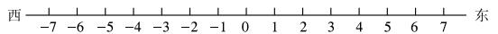

# Mathematics (Grade 6)

**ID**: 046a9023
**难度**: hard
**题型**: fill_in_the_blank

## 题目
看图填一埴。

（1）小丽现在在O点处，向西走2格表示为-2，那么向东走2格表示为（）。
（2）如果小丽现在的位置是+6，表示她从0点向（）行了（）格。
（3）如果小丽现在的位置是-7，表示她从0点向（）行了（）格。
（4）从0点出发，小丽先向西行了6格，又向东行了5格 ，她这时的位置表示为（）。
（5）从0点出发，小丽先向西行了4格，又向东行了7格 ，她这时的位置表示为（）。
（6）从0点出发，小丽先向东行了5格，叉向西行了5格 ，她这时的位置表示为（）。

## 解答

**答案**: +2, 东, 6, 西, 7, -1, +3, 0

1. Step1:根据向西为负，向东为正，小丽在O点处，向西走2格表示为-2，所以向东走2格表示为+2
2. Step2:因为向东为正，位置是+6，所以表示从0点向东行了6格
3. Step3:由于向西为负，位置是-7，所以表示从0点向西行了7格
4. Step4:从0点出发，向西6格记为-6，向东5格记为+5，-6 + 5 = -1，所以这时位置表示为-1
5. Step5:从0点出发，向西4格记为-4，向东7格记为+7，-4 + 7 = 3，所以这时位置表示为+3
6. Step6:从0点出发，向东5格记为+5，向西5格记为-5，+5 + (-5) = 0，所以这时位置表示为0

## 知识点

**知识点**:
  - 负数的认识

---
