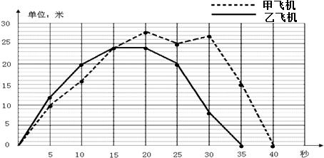

# Mathematics (Grade 6)

**ID**: 05a971f5
**难度**: hard
**题型**: fill_in_the_blank

## 题目
如图是航模小组制作的两架航模飞机在一次飞行中飞行时间和高度的记录，根据统计图填空．
（1）如图是$\underline{\hspace{5em}}$统计图．
（2）甲飞机飞行了$\underline{\hspace{5em}}$秒，乙飞机飞行了$\underline{\hspace{5em}}$秒．
（3）甲飞机的飞行时间比乙飞机长百分之几？

## 解答

**答案**: 折线, 40, 35, 14.3%

1. Step1:观察统计图的形式，可知这是折线统计图
2. Step2:从统计图中读取甲飞机飞行时间对应的横坐标值，得到甲飞机飞行了40秒
3. Step3:从统计图中读取乙飞机飞行时间对应的横坐标值，得到乙飞机飞行了35秒
4. Step4:计算甲飞机比乙飞机飞行时间长的秒数，即40 - 35 = 5秒
5. Step5:用长的秒数除以乙飞机飞行时间，即5÷35，得到约14.3%

## 知识点

**知识点**:
  - 复式折线统计图；百分数的实际应用；从统计图表中获取信息．

---
