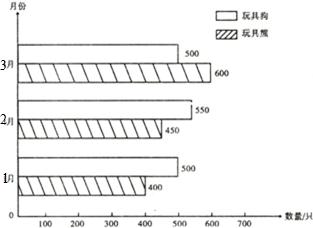

# Mathematics (Grade 6)

**ID**: 079813ca
**难度**: hard
**题型**: fill_in_the_blank

## 题目
看图回答问题．
某玩具厂第一季度生产毛绒玩具情况统计图

（1）$\underline{\hspace{5em}}$月玩具狗的产量最高．
（2）$\underline{\hspace{5em}}$月玩具熊的产量最高．
（3）$\underline{\hspace{5em}}$月生产毛绒玩具的总产量最高．
（4）第一季度一共生产$\underline{\hspace{5em}}$只玩具熊．
（5）第一季度一共生产$\underline{\hspace{5em}}$只玩具．
（6）你还能得到哪些信息？

## 解答

**答案**: 2, 3, 3, 1450, 2000

1. Step1:观察条形统计图，确定玩具狗产量最高的月份，得出2月玩具狗产量最高
2. Step2:观察条形统计图，确定玩具熊产量最高的月份，得出3月玩具熊产量最高
3. Step3:计算1月毛绒玩具总产量为550 + 450 = 1000只，2月毛绒玩具总产量为500 + 400 = 900只，3月毛绒玩具总产量为500 + 600 = 1100只，比较得出3月生产毛绒玩具的总产量最高
4. Step4:计算第一季度玩具熊总产量为400 + 450 + 600 = 1450只
5. Step5:计算第一季度玩具总产量为1000 + 900 + 1100 = 3000只

## 知识点

**知识点**:
  - 两种不同形式的复式条形统计图；从统计图表中获取信息．

---
