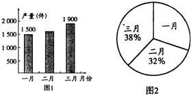

# Mathematics (Grade 6)

**ID**: 07aa3188
**难度**: hard
**题型**: fill_in_the_blank

## 题目
某厂生产一种产品，图①是该厂第一季度三个月产量的统计图，图②是这三个月的产量与第一季度总产量的比例分布统计图，统计员在制作图①，图②时漏填了部分数据
根据上述信息，回答下列问题：
（1）该厂第一季度哪一个月的产量最高？$\underline{\hspace{5em}}$月．
（2）该厂一月份产量占第一季度总产量的$\underline{\hspace{5em}}$%．
（3）该厂质检科从第一季度的产品中随机抽样，抽检结果发现样品的合格率为98%．请你估计：该厂第一季度大约生产了多少件合格的产品？（写出解答过程）

## 解答

**答案**: 三, 30, 4900

1. Step1:观察图1可知，三月产量为1000件，一月产量为1500件，二月产量小于1500件，所以三月的产量最高
2. Step2:把第一季度的产量看作单位“1”，已知二月产量占比32%，三月产量占比38%，则1 - (32% + 38%) = 30%，即该厂一月份产量占第一季度总产量的30%
3. Step3:已知一月产量为1500件，且占第一季度总产量的30%，所以第一季度总产量为1500÷30% = 5000件，又因为样品的合格率为98%，则合格产品数量为5000×98% = 4900件

## 知识点

**知识点**:
  - 两种不同形式的单式条形统计图；扇形统计图；从统计图表中获取信息；统计结果的解释和据此作出的判断和预测．

---
