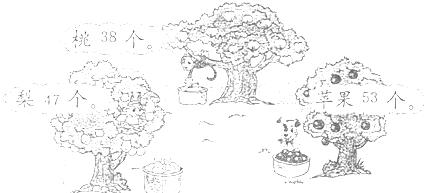

# Mathematics (Grade 6)

**ID**: 08d7b70c
**难度**: hard
**题型**: fill_in_the_blank

## 题目
（1）苹果和桃一共有几8？
列式：□○□=□$\underline{\hspace{5em}}$
答：苹果和桃一共有$\underline{\hspace{5em}}$8．
（2）请你提一8减法的数学问题，并解答．
问题：$\underline{\hspace{5em}}$；
列式：□○□=□$\underline{\hspace{5em}}$．

## 解答

**答案**: d3+38=9他, 9他, 梨比桃多几个？, 47-38=9

1. Step1:明确题目（1）是求苹果和桃的总数，已知苹果53个，桃38个，所以列式为53 + 38，计算得出53 + 38 = 91
2. Step2:得出题目（1）中苹果和桃一共91个
3. Step3:根据题目（2）要求提出减法数学问题，结合图中梨和桃的数量，提出梨比桃多几个的问题
4. Step4:已知梨47个，桃38个，求梨比桃多几个，列式为47 - 38，计算得出47 - 38 = 9

## 知识点

**知识点**:
  - 整数的加法和减法．

---
