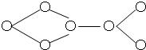

# Mathematics (Grade 6)

**ID**: 0921f1ec
**难度**: hard
**题型**: fill_in_the_blank

## 题目
用红、黄、蓝三种颜色涂在图中的圆圈中，每个圆圈只涂一种颜色，并用要使每条连线两端的圆圈涂上不同的颜色，一共有$\underline{\hspace{5em}}$种不同的涂法．

## 解答

**答案**: 144

1. Step1:确定最左侧圆圈的涂法，因为有红、黄、蓝三种颜色，所以有3种涂法
2. Step2:确定与最左侧圆圈相连的圆圈的涂法，由于每条连线两端的圆圈颜色不同，此时还剩2种颜色，所以有2种涂法
3. Step3:确定与上一步所涂圆圈相连的两个圆圈的涂法，此时这两个圆圈各自都有2种选择，根据分步乘法计数原理，这两个圆圈共有2×2 = 4种涂法
4. Step4:确定最右侧三个相连圆圈的涂法，经分析有6种涂法
5. Step5:根据分步乘法计数原理，将上述每一步的涂法数相乘，即3×2×4×6 = 144种涂法

## 知识点

**知识点**:
  - 排列组合．

---
