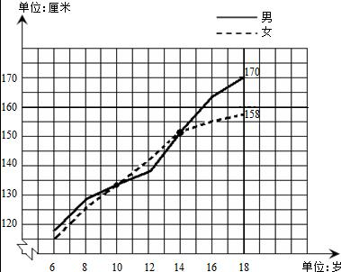

# Mathematics (Grade 6)

**ID**: 09bf047b
**难度**: hard
**题型**: fill_in_the_blank

## 题目
某地6～18岁男女生平均身高情况统计图
（1）图中两条折线有2个交点，左边第一个交点说明：从$\underline{\hspace{5em}}$岁开始，$\underline{\hspace{5em}}$生的平均身高开始超过$\underline{\hspace{5em}}$生；第二个交点说明：从$\underline{\hspace{5em}}$岁开始，$\underline{\hspace{5em}}$生的平均身高开始超过$\underline{\hspace{5em}}$生．
（2）该地区18岁的男生的平均身高比18岁的女生高$\frac{()}{()}$．

## 解答

**答案**: 10, 女, 男, 14, 男, 女, 6/79

1. Step1:观察统计图的图例，明确实线代表男生，虚线代表女生
2. Step2:查看两条折线的第一个交点，其对应的横坐标为10岁，在10岁之前男生折线高于女生折线，10岁开始女生折线高于男生折线，所以从10岁开始，女生的平均身高开始超过男生
3. Step3:查看两条折线的第二个交点，其对应的横坐标为14岁，14岁开始男生折线高于女生折线，所以从14岁开始，男生的平均身高开始超过女生
4. Step4:从图中获取18岁男生平均身高为170厘米，18岁女生平均身高为158厘米
5. Step5:计算18岁男生与女生平均身高的差值为170 - 158 = 12厘米
6. Step6:计算该地区18岁的男生的平均身高比18岁的女生高的比例，即12÷158 = 6/79

## 知识点

**知识点**:
  - 复式折线统计图；从统计图表中获取信息．

---
