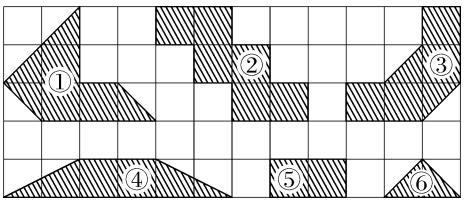

# Mathematics (Grade 6)

**ID**: 0b35e16e
**难度**: hard
**题型**: fill_in_the_blank

## 题目
每一个小方格表示1平方厘米。

1.（）的面积最大，是（）平方厘米。
2.（）和（）的面积相等，是（）平方厘米。
3.（）的面积最小，是（）平方厘米。

## 解答

**答案**: ②, 6, ①, ③, 5, ⑥, 1

1. Step1:计算①号图面积，整格有3个，半格有4个，4÷2=2，3 + 2 = 5平方厘米
2. Step2:②号图整格有6个，面积是6平方厘米
3. Step3:计算③号图面积，整格有4个，半格有2个，2÷2=1，4 + 1 = 5平方厘米
4. Step4:计算④号图面积，整格有2个，半格有4个，4÷2=2，2 + 2 = 4平方厘米
5. Step5:⑤号图整格有2个，面积是2平方厘米
6. Step6:计算⑥号图面积，半格有2个，2÷2=1，面积是1平方厘米
7. Step7:比较各图形面积大小，6＞5＞4＞2＞1，所以面积最大的是②，为6平方厘米
8. Step8:因为①和③面积都为5平方厘米，所以①和③面积相等
9. Step9:面积最小的是⑥，为1平方厘米

## 知识点

**知识点**:
  - 转化法求组合图形的面积(奥数)

---
