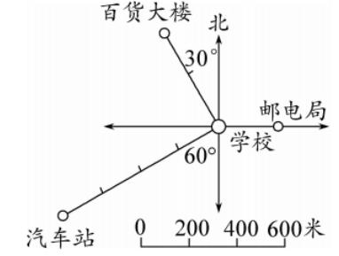

# Mathematics (Grade 6)

**ID**: 0d6c1527
**难度**: hard
**题型**: fill_in_the_blank

## 题目
下面是小明以学校为观测点画出的一张平面图。

（1）邮电局在学校（）方向（）米处。
（2）百货大楼在学校（）偏（）（）°方向（）米处。
（3）汽车站在学校（）偏（）（）°方向（）米处。

## 解答

**答案**: 正东, 200, 北, 西, 30, 400, 南, 西, 60, 800

1. Step1:根据平面图方向上北下南，左西右东，可知邮电局在学校的正东方向
2. Step2:由图中比例尺可知图上1厘米代表实际距离200米，邮电局到学校图上距离为1厘米，所以实际距离为1×200 = 200米
3. Step3:观察可知百货大楼在学校北偏西方向，角度为30°
4. Step4:百货大楼到学校图上距离为2厘米，实际距离为2×200 = 400米
5. Step5:观察可知汽车站在学校南偏西方向，角度为60°
6. Step6:汽车站到学校图上距离为4厘米，实际距离为4×200 = 800米

## 知识点

**知识点**:
  - 根据方向和距离确定物体的位置;比例尺的认识

---
