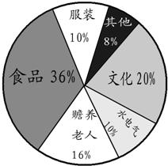

# Mathematics (Grade 6)

**ID**: 0d6d878b
**难度**: hard
**题型**: fill_in_the_blank

## 题目
下图是聪聪家2014年6月的生活开支情况统计图．根据统计图完成下面各题．
（1）图中，整个圆表示(    )．
（2）水电气支出占总支出的(    )%，文化支出占总支出的(    )%．
（3）(    )支出最多，占总支出的(    )%．
（4）(    )支出和(    )支出同样多．
（5）完成下表．
$\begin{array}{|c|c|c|c|c|c|c|c|}
\hline
 & 合计 & 服装 & 赡养老人 & 食品 & 水电气 & 文化 & 其他 \\ \hline
支出（元） & 3000 &  &  &  &  &  &  \\ \hline
\end{array}$

## 解答

**答案**: 聪聪家2014年6月的生活总开支, 10, 20, 食品, 36, 服装, 水电气, 300, 480, 1080, 300, 600, 240

1. Step1:根据扇形统计图的意义可知，图中整个圆表示聪聪家2014年6月的生活总开支
2. Step2:从扇形统计图中直接获取水电气支出占总支出的10%
3. Step3:从扇形统计图中直接获取文化支出占总支出的20%
4. Step4:观察扇形统计图，比较各部分占比大小，得出食品支出最多，占总支出的36%
5. Step5:观察扇形统计图，发现服装支出和水电气支出占比均为10%，所以服装支出和水电气支出同样多
6. Step6:计算服装支出的钱数，3000×10% = 300元
7. Step7:计算赡养老人支出的钱数，3000×16% = 480元
8. Step8:计算食品支出的钱数，3000×36% = 1080元
9. Step9:计算水电气支出的钱数，3000×10% = 300元
10. Step10:计算文化支出的钱数，3000×20% = 600元
11. Step11:计算其他支出的钱数，3000×8% = 240元

## 知识点

**知识点**:
  - 扇形统计图；从统计图表中获取信息；统计图表的填补．

---
