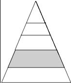

# Mathematics (Grade 6)

**ID**: 0fc8bafe
**难度**: hard
**题型**: fill_in_the_blank

## 题目
图中三角形ABC的面积是75cm$^{2}$，把三角形ABC的边AB和AC都五等分，阴影部分的面积是$\underline{\hspace{5em}}$cm$^{2}$．

## 解答

**答案**: 21

1. Step1:因为三角形ABC的边AB和AC都五等分，所以得出△AFP∽△AGQ∽△ABC
2. Step2:由相似三角形性质可知，相似三角形面积比等于相似比的平方，所以得到rac{AF}{AB}=rac{3}{5}，rac{AG}{AB}=rac{4}{5}，进而推出S_{△AFP}：S_{△ABC}=rac{9}{25}，S_{△AGQ}：S_{△ABC}=rac{16}{25}
3. Step3:由于阴影部分的面积为S_{△AGQ}-S_{△AFP}，所以可得S_{△AGQ}-S_{△AFP}=（rac{16}{25}-rac{9}{25}）×S_{△ABC}
4. Step4:已知S_{△ABC}=75cm^{2}，将其代入上式，计算rac{7}{25}×75，得出结果为21cm^{2}

## 知识点

**知识点**:
  - 相似三角形的性质（份数、比例）．

---
