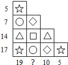

# Mathematics (Grade 6)

**ID**: 10745386
**难度**: hard
**题型**: fill_in_the_blank

## 题目

(2012•广州)如图，不同的图形代表不同的数，方格外的数分别表示所在的这一行或这一列中全体图形所代表的数之和，比如第二行中“7=○+◇”，根据图示所表示的关系，可以推算出？=______．

## 解答

**答案**: 9

1. Step1:根据方格外的数表示所在行或列全体图形代表的数之和，得出☆=5
2. Step2:由☆+○+△+☆=19和☆=5，可得○+△=19 - 5 - 5 = 9
3. Step3:因为○+◇=7，结合○+△=9，得出△=◇+2
4. Step4:由△+◇=10和△=◇+2，可得△+△ - 2 = 10，进而算出△=(10 + 2)÷2 = 6
5. Step5:把△=6代入△+□+△=14，得出□=14 - 6×2 = 2
6. Step6:因为○+◇=7，□=2，所以？=○+□+◇=7 + 2 = 9

## 知识点

**知识点**:
  - 数表中的规律．

---
