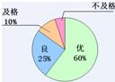

# Mathematics (Grade 6)

**ID**: 12a3e02b
**难度**: hard
**题型**: fill_in_the_blank

## 题目
如图是某班同学期末考试成绩统计图．
根据统计图，完成下面问题．
（1）在这个扇形统计图中，用整个圆表示$\underline{\hspace{5em}}$．
（2）$\underline{\hspace{5em}}$的人最多，$\underline{\hspace{5em}}$ 的人最少．
（3）如果这个班有60人，那么得优的有$\underline{\hspace{5em}}$人，得良的有$\underline{\hspace{5em}}$人．

## 解答

**答案**: 某班同学, 优, 不及格, 36, 15

1. Step1:根据扇形统计图的意义，可知在这个扇形统计图中，用整个圆表示某班同学
2. Step2:观察扇形统计图中各部分所占比例，得出优所占比例最大，不及格所占比例最小，所以优的人最多，不及格的人最少
3. Step3:已知班级总人数为60人，得优的人数为总人数乘以优所占的比例，即60×60% = 36人
4. Step4:已知班级总人数为60人，得良的人数为总人数乘以良所占的比例，即60×25% = 15人

## 知识点

**知识点**:
  - 统计图表的综合分析、解释和应用．

---
