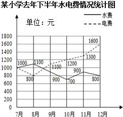

# Mathematics (Grade 6)

**ID**: 13c2a94c
**难度**: hard
**题型**: fill_in_the_blank

## 题目
（1）这个图叫$\underline{\hspace{5em}}$统计图．
（2）$\underline{\hspace{5em}}$月份的电费最多，是$\underline{\hspace{5em}}$元．
（3）下半年平均每月开支水费$\underline{\hspace{5em}}$元．
（4）去年下半年电费呈$\underline{\hspace{5em}}$趋势．
（5）8月份水费比电费多$\underline{\hspace{5em}}$元，多$\underline{\hspace{5em}}$%．

## 解答

**答案**: 复式折线, 12, 1600, 900, 上升, 300, 37.5

1. Step1:观察统计图，根据其特征判断这个图叫复式折线统计图
2. Step2:观察统计图中电费的折线，找到最高点对应的月份为12月，其电费是1600元
3. Step3:将下半年6个月的水费1000、1100、900、700、900、800相加，即1000+1100+900+700+900+800=5400，再除以6，5400÷6=900，得到下半年平均每月开支水费900元
4. Step4:观察统计图中电费折线的走势，得出去年下半年电费呈上升趋势
5. Step5:用8月份水费1100元减去电费800元，1100 - 800 = 300，得到8月份水费比电费多300元
6. Step6:用8月份水费比电费多的300元除以电费800元，300÷800 = 0.375，转化为百分数为37.5%，得到8月份水费比电费多37.5%

## 知识点

**知识点**:
  - 复式折线统计图．

---
