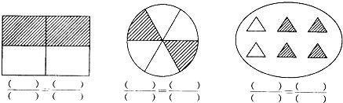

# Mathematics (Grade 6)

**ID**: 1456ec92
**难度**: hard
**题型**: fill_in_the_blank

## 题目
用不同分数表示下图中的阴影部分．
。

## 解答

**答案**: $\frac{2}{4}$, $\frac{1}{2}$, $\frac{2}{6}$, $\frac{1}{3}$, $\frac{4}{6}$, $\frac{2}{3}$

1. Step1:观察第一个图形，将正方形看作单位“1”，其被平均分成4份，阴影部分占2份，根据分数的意义，用分数表示为$\frac{2}{4}$，再进行约分得到$\frac{1}{2}$
2. Step2:观察第二个图形，把圆看作单位“1”，其被平均分成6份，阴影部分占2份，根据分数的意义，用分数表示为$\frac{2}{6}$，再进行约分得到$\frac{1}{3}$
3. Step3:观察第三个图形，将所有小三角形看作单位“1”，其被平均分成6份，阴影部分占4份，根据分数的意义，用分数表示为$\frac{4}{6}$，再进行约分得到$\frac{2}{3}$

## 知识点

**知识点**:
  - 分数的意义、读写及分类．

---
