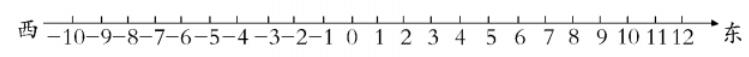

# Mathematics (Grade 6)

**ID**: 14bdc04d
**难度**: hard
**题型**: fill_in_the_blank

## 题目
下图中每格表示1m，小明刚开始的位置在“0”处。

（1）小明从0处向西行4m，表示为-4m，那么他从0处向东行9m，记作（）m。
（2）如果小明的位置是+11m，说明他是从0处向（）行（）m。
（3）如果小明的位置是-9m，说明他是从0处向（）行（）m。

## 解答

**答案**: +9, 东, 11, 西, 9

1. Step1:根据题意可知向东行记为“+”，所以从0处向东行9m，记作+9m，得到（1）的答案为+9
2. Step2:因为向东行记为“+”，小明位置是+11m，所以说明他是从0处向东行，且行的距离是11m，得到（2）中方向为东，距离为11
3. Step3:由于向西行记为“-”，小明位置是-9m，所以说明他是从0处向西行，行的距离是9m，得到（3）中方向为西，距离为9

## 知识点

**知识点**:
  - 负数的认识

---
