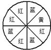

# Mathematics (Grade 6)

**ID**: 15bdd1a7
**难度**: hard
**题型**: fill_in_the_blank

## 题目
如图的转盘中涂红色的部分占这个图形的$\underline{\hspace{5em}}$，涂黄色的部分占这个图形的$\underline{\hspace{5em}}$，涂蓝色的部分占这个图形的$\underline{\hspace{5em}}$，如果让这个圆盘转动起来，当停下时，指针在$\underline{\hspace{5em}}$部分的可能性最大，指在$\underline{\hspace{5em}}$部分的可能性最小．

## 解答

**答案**: 1/2, 1/8, 3/8, 红色, 黄色

1. Step1:观察发现转盘被平均分成8份
2. Step2:计算红色部分占比，4÷8=4/8=1/2
3. Step3:计算黄色部分占比，1÷8=1/8
4. Step4:计算蓝色部分占比，3÷8=3/8
5. Step5:比较占比大小，1/2＞3/8＞1/8
6. Step6:得出指针在红色部分可能性最大，在黄色部分可能性最小

## 知识点

**知识点**:
  - 可能性的大小．

---
