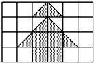

# Mathematics (Grade 6)

**ID**: 15f771c7
**难度**: hard
**题型**: fill_in_the_blank

## 题目
图中每个方格的面积是1平方厘米．那么阴影部分占整个图形的$\underline{\hspace{5em}}$分之$\underline{\hspace{5em}}$．

## 解答

**答案**: 二十四, 七

1. Step1:由每个方格面积是1平方厘米，数出图中共有24个方格，得出整个图形面积为24平方厘米
2. Step2:观察阴影部分，数出完整方格有4个，其面积为4×1 = 4平方厘米
3. Step3:数出阴影部分半方格有6个，其面积为6×(1÷2) = 3平方厘米
4. Step4:计算阴影部分面积为4 + 3 = 7平方厘米
5. Step5:根据分数意义，用阴影部分面积7平方厘米作分子，整个图形面积24平方厘米作分母，得出阴影部分占整个图形的二十四分之七

## 知识点

**知识点**:
  - 组合图形的面积；分数除法．

---
