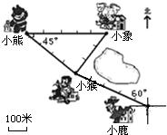

# Mathematics (Grade 6)

**ID**: 16ee50aa
**难度**: hard
**题型**: fill_in_the_blank

## 题目
明天是小猴的生日，小熊、小象、小鹿约好明天10：00准时到小猴家为它庆祝生日．已知它们的行进速度都是50米/分．
（1）小熊最迟应该在明天 9：52出发，沿$\underline{\hspace{5em}}$偏$\underline{\hspace{5em}}$45°的方向行进，才能准时赴约．
（2）小鹿最迟应该在明天$\underline{\hspace{5em}}$出发，沿$\underline{\hspace{5em}}$偏$\underline{\hspace{5em}}$°的方向行进，才能准时赴约．

## 解答

**答案**: 东, 南, 9:50, 北, 西60

1. Step1:根据图例可知小熊去小猴家的方向为东偏南45°，所以第一个空填东，第二个空填南
2. Step2:由图可知小鹿到小猴家图上距离为5厘米，根据比例尺1:10000，可得实际距离为5÷(1/10000)=50000厘米，换算单位为500米
3. Step3:已知行进速度为50米/分，根据时间 = 路程÷速度，可得小鹿到小猴家所需时间为500÷50 = 10分钟
4. Step4:已知要10：00准时到，用10时减去所需的10分钟，得出小鹿最迟出发时间为9：50，所以第三个空填9:50
5. Step5:根据图例可知小鹿去小猴家的方向为北偏西60°，所以第四个空填北，第五个空填西60

## 知识点

**知识点**:
  - 根据方向和距离确定物体的位置；简单的行程问题．

---
