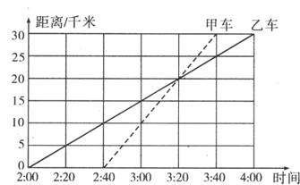

# Mathematics (Grade 6)

**ID**: 1ae3a7a9
**难度**: hard
**题型**: fill_in_the_blank

## 题目
看图填空．
（1）$\underline{\hspace{5em}}$车先行完30千米．
（2）乙车比甲车先行$\underline{\hspace{5em}}$分．
（3）甲车的速度是$\underline{\hspace{5em}}$千米/时．
（4）乙车每时比甲车每时少行$\underline{\hspace{5em}}$千米．

## 解答

**答案**: 甲, 40, 30, 15

1. Step1:观察图表可知，甲车行完30千米的时间是3：40 - 2：40 = 1小时，乙车行完30千米的时间是4：00 - 2：00 = 2小时，因为1小时小于2小时，所以先行完30千米的是甲车
2. Step2:由图表可得，乙车2：00出发，甲车2：40出发，所以乙车比甲车先行的时间为2：40 - 2：00 = 40分钟
3. Step3:根据速度 = 路程÷时间，甲车行30千米用了1小时，所以甲车速度为30÷1 = 30千米/时
4. Step4:根据速度 = 路程÷时间，乙车行30千米用了2小时，所以乙车速度为30÷2 = 15千米/时，那么乙车每时比甲车每时少行30 - 15 = 15千米

## 知识点

**知识点**:
  - 复式折线统计图．

---
