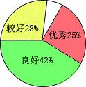

# Mathematics (Grade 6)

**ID**: 1bfa8d14
**难度**: hard
**题型**: fill_in_the_blank

## 题目

(2008•塘沽区)某次六年级数学考试分析如统计图．
(1)空白部分为不及格占______%，及格率为______%
(2)已知126人为成绩良好，六年级参加考试的有______人．

## 解答

**答案**: 5, 95, 300

1. Step1:计算及格率，将较好、优秀、良好所占百分数相加，即28% + 25% + 42% = 95%
2. Step2:计算不及格所占百分数，用1减去及格率，即1 - 95% = 5%
3. Step3:计算六年级参加考试的人数，用良好的人数126除以良好人数所占的百分数42%，即126÷42% = 300人

## 知识点

**知识点**:
  - 扇形统计图;从统计图表中获取信息．

---
