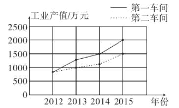

# Mathematics (Grade 6)

**ID**: 1d394f26
**难度**: hard
**题型**: fill_in_the_blank

## 题目
下面是金星纺织厂的第一、二车间工业产值增长情况统计图。

（1）2012～2015年，第（）车间的工业产值增长得最快，（）年两车间的工业产值相差最大。
（2）第一车间2015年的工业产值比2014年增长（）万元。
（3）请你简单评判一下两个车间的工业产值增长情况。

## 解答

**答案**: 一, 2015, 500, 第一车间增长幅度比较大，第二车间增长速度比较小

1. Step1:观察复式折线统计图，比较第一车间和第二车间折线的陡峭程度，由于第一车间折线更陡，所以得出2012～2015年第一车间的工业产值增长得最快
2. Step2:观察统计图中每年两车间对应折线点的高低差距，发现2015年差距最大，因此得出2015年两车间的工业产值相差最大
3. Step3:从统计图中获取第一车间2015年工业产值为2000万元，2014年工业产值为1500万元，计算2000 - 1500 = 500万元，所以第一车间2015年的工业产值比2014年增长500万元
4. Step4:综合比较两车间折线走势，第一车间折线上升幅度大，第二车间折线上升幅度小，从而评判出第一车间增长幅度比较大，第二车间增长速度比较小

## 知识点

**知识点**:
  - 复式折线统计图

---
