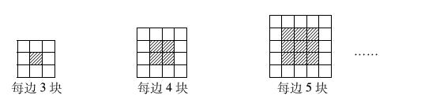

# Mathematics (Grade 6)

**ID**: 1e5f1749
**难度**: hard
**题型**: fill_in_the_blank

## 题目
如下图，如果按此画法继续画下去，那么：
（1）当中间涂色的方块有121块时，每边有（）块。
（2）当每边有n块时，没有涂色的方块有（）块。

## 解答

**答案**: 13, 4n-4

1. Step1:根据解析2，在实心方阵中，中间涂色部分边的正方形个数比外边大正方形边的个数少2。已知中间涂色方块有121块，先找出121是哪个数的平方，因为121=11×11，所以中间涂色部分正方形边的个数是11。
2. Step2:根据Step1及解析2，用中间涂色部分正方形边的个数加上2求出大正方形边上小正方形的个数，即11 + 2 = 13，所以当中间涂色的方块有121块时，每边有13块。
3. Step3:根据解析2，当每边有n块时，求没有涂色的方块个数，用每边正方形的块数乘4再减去4，即没有涂色的方块有4n - 4块。

## 知识点

**知识点**:
  - 图形中的规律

---
