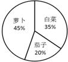

# Mathematics (Grade 6)

**ID**: 1ea85e5e
**难度**: hard
**题型**: fill_in_the_blank

## 题目
一块地共30公顷，里面种了白菜、萝卜、茄子，如图所示：
（1）这块地种植茄子 $\underline{\hspace{5em}}$ 公顷，种植白菜 $\underline{\hspace{5em}}$ 公顷．
（2）种萝卜比白菜多占这块地的 $\underline{\hspace{5em}}$ %．，多 $\underline{\hspace{5em}}$ 公顷．

## 解答

**答案**: 6, 10.5, 10, 3

1. Step1:根据题目，已知这块地总面积为30公顷，茄子占比20%，用总面积乘以茄子占比，即30×20%，可得出种植茄子的公顷数为6公顷
2. Step2:已知白菜占比35%，用总面积30公顷乘以白菜占比35%，即30×35%，可得出种植白菜的公顷数为10.5公顷
3. Step3:已知萝卜占比45%，白菜占比35%，用萝卜占比减去白菜占比，即45% - 35%，可得出种萝卜比白菜多占这块地的百分比为10%
4. Step4:由上一步得到种萝卜比白菜多占这块地的10%，再用这块地的总面积30公顷乘以多占的百分比10%，即10%×30，可得出种萝卜比白菜多的公顷数为3公顷

## 知识点

**知识点**:
  - 扇形统计图

---
