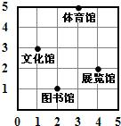

# Mathematics (Grade 6)

**ID**: 1ede6ff6
**难度**: hard
**题型**: fill_in_the_blank

## 题目
如图，文化馆的位置为（ 1，3 ），那么图书馆的位置为（$\underline{\hspace{5em}}$，$\underline{\hspace{5em}}$）；位置为（ 3，5 ）的是$\underline{\hspace{5em}}$馆；与文化馆距离最近的是$\underline{\hspace{5em}}$馆．

## 解答

**答案**: 2, 1, 体育, 图书

1. Step1:根据数对中前面的数表示列，后面的数表示行，由图可知图书馆在第2列第1行，所以图书馆的位置为（2，1）
2. Step2:同样根据数对表示规则，位置为（3，5）的在图中对应的是体育馆
3. Step3:分别计算文化馆到各场馆的格子数，文化馆到图书馆，横向1个格子，纵向2个格子，共1 + 2 = 3个格子；文化馆到展览馆，横向3个格子，纵向1个格子，共3 + 1 = 4个格子；文化馆到体育馆，横向2个格子，纵向2个格子，共2 + 2 = 4个格子
4. Step4:比较格子数，3＜4，所以与文化馆距离最近的是图书馆

## 知识点

**知识点**:
  - 数对与位置；根据方向和距离确定物体的位置．

---
