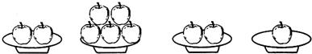

# Mathematics (Grade 6)

**ID**: 1fe35cd8
**难度**: hard
**题型**: fill_in_the_blank

## 题目
图中共有$\underline{\hspace{5em}}$盘子，共有$\underline{\hspace{5em}}$个苹果，从左往右数，第$\underline{\hspace{5em}}$盘和第$\underline{\hspace{5em}}$盘苹果的个数同样多，从右往左数，第$\underline{\hspace{5em}}$盘苹果最多，第$\underline{\hspace{5em}}$盘最少．

## 解答

**答案**: 4, 10, 1, 3, 3, 1

1. Step1:观察图片，数出盘子的数量，可得共有4个盘子
2. Step2:分别数出每个盘子中苹果的数量，依次为2、5、2、1，将其相加2 + 5 + 2 + 1 = 10，得出共有10个苹果
3. Step3:确定从左往右的方向，数出每个盘子苹果数量，发现第1盘和第3盘苹果个数都是2，所以从左往右数，第1盘和第3盘苹果的个数同样多
4. Step4:确定从右往左的方向，数出每个盘子苹果数量，分别为1、2、5、2，比较可得第3盘苹果最多，第1盘最少

## 知识点

**知识点**:
  - 图文应用题．

---
