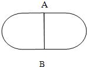

# Mathematics (Grade 6)

**ID**: 21afba37
**难度**: hard
**题型**: fill_in_the_blank

## 题目
如图大圈是400米跑道，由A到B的跑道长是200米，直线距离是70米，父子俩同时从A点出发逆时针方向沿跑道进行长跑锻炼，儿子跑大圈，父亲每跑到B点便沿直线跑，父亲每跑100米用20秒，儿子每跑100米用19秒，如果他们按这样的速度跑，儿子在跑第$\underline{\hspace{5em}}$圈时，第一次与父亲再相遇．

## 解答

**答案**: 8

1. Step1:计算儿子跑一圈所用时间，根据儿子每跑100米用19秒，跑道400米，可得（400÷100）×19 = 76秒，即儿子每76秒到达A点一次
2. Step2:计算父亲跑一次（从A到B再沿直线回到A）所用时间，根据父亲每跑100米用20秒，路程为200 + 70米，可得（200 + 70）÷100×20 = 54秒，即父亲每54秒到达A点一次
3. Step3:计算在从A到B逆时针这段路上儿子和父亲所用时间，儿子：76÷2 = 38秒，父亲：200÷100×20 = 40秒，可知父亲比儿子多用40 - 38 = 2秒
4. Step4:明确只要父亲到达A点后的2秒之内儿子也到达A点，儿子就能追上父亲，所以要找76的一个整数倍（此为父子相遇时儿子跑完的圈数），它比54的一个整数倍大，但至多大2，即找一个76的倍数，它除以54的余数在0～2之间
5. Step5:通过试算，76×5÷54 = 7…2，可知父子第一次相遇时，儿子已跑完第7圈，正在跑第8圈

## 知识点

**知识点**:
  - 环形跑道问题．

---
