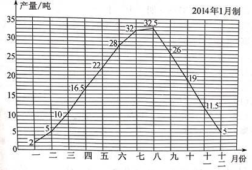

# Mathematics (Grade 6)

**ID**: 21d1f320
**难度**: hard
**题型**: fill_in_the_blank

## 题目
下面是某地冷饮厂2013年每月冷饮生产变化情况统计图
某地冷饮厂2013年每月冷饮生产变化情况统计图

(1)根据图中的数据完成下表。
$\begin{array}{|c|c|c|c|c|c|c|c|c|c|c|c|c|}
\hline
月份
 & 一
 & 二
 & 三
 & 四
 & 五
 & 六
 & 七
 & 八
 & 九
 & 十
 & 十一
 & 十二
 \\\hline
产量(吨)
 & （\underline{\hspace{5em}}）
 & （\underline{\hspace{5em}}）
 & （\underline{\hspace{5em}}）
 & （\underline{\hspace{5em}}）
 & （\underline{\hspace{5em}}）
 & （\underline{\hspace{5em}}）
 & （\underline{\hspace{5em}}）
 & （\underline{\hspace{5em}}）
 & （\underline{\hspace{5em}}）
 & （\underline{\hspace{5em}}）
 & （\underline{\hspace{5em}}）
 & （\underline{\hspace{5em}}）
 \\\hline
\end{array}$
(2)（________）月份的冷饮产量最高,（________）月份的冷饮产量最低。
(3)（________）月份至（________）月份之间的冷饮产量上升得最快（________）月份至（________）月份之间的冷饮产量下降得最快。

## 解答

**答案**: 2, 5, 10, 16.5, 22, 28, 32, 32.5, 26, 19, 11.5, 5, 八, 一, 三, 四, 十, 十一

1. Step1:观察统计图，获取一月份产量为2吨
2. Step2:获取二月份产量为5吨
3. Step3:获取三月份产量为10吨
4. Step4:获取四月份产量为16.5吨
5. Step5:获取五月份产量为22吨
6. Step6:获取六月份产量为28吨
7. Step7:获取七月份产量为32吨
8. Step8:获取八月份产量为32.5吨
9. Step9:获取九月份产量为26吨
10. Step10:获取十月份产量为19吨
11. Step11:获取十一月份产量为11.5吨
12. Step12:获取十二月份产量为5吨
13. Step13:比较各月产量，得出八月份产量最高
14. Step14:得出一月份产量最低
15. Step15:分析产量上升情况，得出三月至四月产量上升最快
16. Step16:分析产量下降情况，得出十月至十一月产量下降最快

## 知识点

**知识点**:
  - 小学数学;统计和概率;统计;统计图表的综合应用

---
