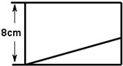

# Mathematics (Grade 6)

**ID**: 22e671bc
**难度**: hard
**题型**: fill_in_the_blank

## 题目
一条线段将一个边长为8cm的正方形分割成一个三角形和一个梯形（如图）．已知梯形面积比三角形面积多40cm$^{2}$，则三角形中较短的直角边的长是$\underline{\hspace{5em}}$cm．

## 解答

**答案**: 3

1. Step1:设三角形中较短的直角边的长是a，因为正方形边长为8cm，所以梯形的上底长是8 - a
2. Step2:根据梯形面积公式S=(上底 + 下底)×高÷2，可得梯形面积为(8 - a + 8)×8÷2；根据三角形面积公式S=底×高÷2，可得三角形面积为8a÷2
3. Step3:由梯形面积比三角形面积多40cm²，列出方程(8 - a + 8)×8÷2 - 8a÷2 = 40
4. Step4:化简方程(8 - a + 8)×8÷2 - 8a÷2 = 40，先计算(8 - a + 8)×8÷2=(16 - a)×4 = 64 - 4a，8a÷2 = 4a，得到64 - 4a - 4a = 40，进一步化简为64 - 8a = 40
5. Step5:对64 - 8a = 40进行求解，等式两边同时加8a，得到64 = 40 + 8a
6. Step6:等式两边同时减40，得到24 = 8a
7. Step7:等式两边同时除以8，得到a = 3

## 知识点

**知识点**:
  - 三角形的周长和面积；长方形、正方形的面积．

---
