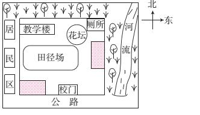

# Mathematics (Grade 6)

**ID**: 23934259
**难度**: hard
**题型**: fill_in_the_blank

## 题目
读某学校校园及周边环境平面图，回答问题。
（1）学校大门朝向（）面，大门口的公路是（）走向的。
（2）学校的教学楼在田径场的（）方向。
（3）学校教学楼的长为32米，若在图中教学楼的长为1.6厘米，则该平面图的比例尺为（）（数字式）

## 解答

**答案**: 南, 东西, 西北, 1:2000

1. Step1:观察平面图，根据上北下南左西右东的方位，确定学校大门朝向南面
2. Step2:同样依据上北下南左西右东，判断大门口的公路是东西走向
3. Step3:通过上北下南左西右东，明确学校的教学楼在田径场的西北方向
4. Step4:将32米换算为3200厘米，因为1米等于100厘米
5. Step5:根据比例尺=图上距离:实际距离，计算得出1.6:3200=1:2000，得到该平面图的比例尺为1:2000

## 知识点

**知识点**:
  - 方向与位置;比例尺的认识

---
