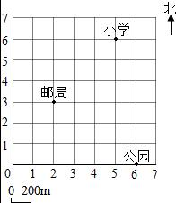

# Mathematics (Grade 6)

**ID**: 26a8fbb4
**难度**: hard
**题型**: fill_in_the_blank

## 题目
按要求填一填．
（1）小学所在的位置可以用数对（ $\underline{\hspace{5em}}$ ， $\underline{\hspace{5em}}$ ）．
（2）邮局的位置在小学的 $\underline{\hspace{5em}}$ 偏 $\underline{\hspace{5em}}$ °的方向上．
（3）公园的位置在邮局的 $\underline{\hspace{5em}}$ 偏 $\underline{\hspace{5em}}$  的方向上，距离约是 $\underline{\hspace{5em}}$ 米．

## 解答

**答案**: 5, 6, 西, 南45, 东, 南45°, 1400

1. Step1:根据用数对表示点的位置的方法，第一个数字表示列数，第二个数字表示行数，观察图可知小学在第5列第6行，所以小学所在位置用数对表示为（5，6），得出第1问答案5和6
2. Step2:依据地图上“上北下南，左西右东”的方向辨别方法，观察邮局和小学的位置关系，可知邮局在小学的西偏南45°方向上，得出第2问答案西、南45
3. Step3:同样依据地图上“上北下南，左西右东”的方向辨别方法，观察公园和邮局的位置关系，可知公园在邮局的东偏南45°方向上；再根据图中比例尺，图上1格代表200米，从邮局到公园有7格，200×7 = 1400米，得出第3问答案东、南45°、1400

## 知识点

**知识点**:
  - 数对与位置

---
