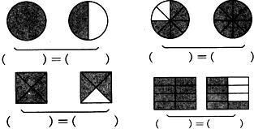

# Mathematics (Grade 6)

**ID**: 2b7604cf
**难度**: hard
**题型**: fill_in_the_blank

## 题目
用假分数和带分数分别表示图中的阴影部分．。

## 解答

**答案**: 1$\frac{1}{2}$=$\frac{3}{2}$, 1$\frac{3}{4}$=$\frac{7}{4}$, 1$\frac{3}{4}$=$\frac{7}{4}$, 1$\frac{5}{8}$=$\frac{13}{8}$

1. Step1:分析图一，一个圆平均分成两份，阴影部分是一个完整圆（单位“1”）加上半份，即1 + 1/2，化为带分数是$1\frac{1}{2}$，化为假分数是3/2
2. Step2:分析图二，一个圆平均分成8份，阴影部分是一个完整圆（单位“1”）加上6份，即1 + 6/8 = 1 + 3/4，化为带分数是$1\frac{3}{4}$，化为假分数是7/4
3. Step3:分析图三，一个正方形平均分成4份，阴影部分是一个完整正方形（单位“1”）加上3份，即1 + 3/4，化为带分数是$1\frac{3}{4}$，化为假分数是7/4
4. Step4:分析图四，一个长方形平均分成8份，阴影部分是一个完整长方形（单位“1”）加上5份，即1 + 5/8，化为带分数是$1\frac{5}{8}$，化为假分数是13/8

## 知识点

**知识点**:
  - 分数的意义、读写及分类;整数、假分数和带分数的互化．

---
