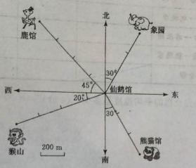

# Mathematics (Grade 6)

**ID**: 2caa019a
**难度**: hard
**题型**: fill_in_the_blank

## 题目
下面是动物园的平面图。

 （1）鹿馆在仙鹤馆的（    ）偏（    ）（    ）方向上，距离是（    ）米。仙鹤馆在鹿馆的（    ）偏（    ）（    ）方向上，距离是（    ）米。
 （2）仙鹤馆在猴山的（    ）偏（    ）（    ）方向上，距离是（    ）米。猴山在仙鹤馆的（    ）偏（    ）（    ）方向上，距离是（    ）米。
 （3）象园在仙鹤馆的（    ）偏（    ）（    ）方向上，距离是（    ）米。
 （4）丁丁在熊猫馆参观完毕，要去仙鹤馆需向（    ）偏（    ）（    ）方向行走（    ）米。丁丁每分钟走80米，（    ）分钟到达仙鹤馆。

## 解答

**答案**: 北, 西, 45°, 800, 南, 东, 45°, 800, 北, 东, 70°, 800, 南, 西, 70°, 800, 北, 东, 30°, 600, 北, 西, 30°, 600, 8

1. Step1:以仙鹤馆为观测点，鹿馆在仙鹤馆的北偏西45°方向上，根据图中比例尺，图上1厘米代表实际距离200米，鹿馆与仙鹤馆图上距离为4厘米，所以实际距离为200×4 = 800米
2. Step2:以鹿馆为观测点，仙鹤馆在鹿馆的南偏东45°方向上，距离与鹿馆到仙鹤馆距离相同，为800米
3. Step3:以猴山为观测点，仙鹤馆在猴山的北偏东70°方向上，猴山与仙鹤馆图上距离为4厘米，实际距离为200×4 = 800米
4. Step4:以仙鹤馆为观测点，猴山在仙鹤馆的南偏西70°方向上，距离为800米
5. Step5:以仙鹤馆为观测点，象园在仙鹤馆的北偏东30°方向上，象园与仙鹤馆图上距离为3厘米，实际距离为200×3 = 600米
6. Step6:以熊猫馆为观测点，丁丁从熊猫馆去仙鹤馆需向北偏西30°方向行走，熊猫馆与仙鹤馆图上距离为3厘米，实际距离为200×3 = 600米
7. Step7:已知丁丁每分钟走80米，根据时间 = 路程÷速度，到达仙鹤馆所需时间为600÷80 = 7.5，题目答案取整为8分钟

## 知识点

**知识点**:
  - --

---
