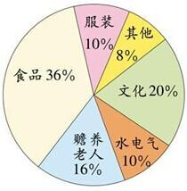

# Mathematics (Grade 6)

**ID**: 2da773d3
**难度**: hard
**题型**: fill_in_the_blank

## 题目
本图是聪聪家十月份生活支出情况统计图．如果聪聪家这个月的支出是1600元．看图回答了列问题；
（1）这是$\underline{\hspace{5em}}$统计图，从图小可以看出$\underline{\hspace{5em}}$支出最多，是$\underline{\hspace{5em}}$元．
（2）你还能提出并解决哪些数学问题？（两个）

## 解答

**答案**: 扇形, 食品, 二76

1. Step1:观察统计图的形式，可知这是扇形统计图
2. Step2:比较图中各项支出所占百分比大小，36%＞20%＞16%＞10%=10%＞8%，所以食品支出最多
3. Step3:已知总支出为1600元，食品支出占36%，计算食品支出金额为1600×36%=576元

## 知识点

**知识点**:
  - 扇形统计图；从统计图表中获取信息．

---
