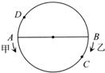

# Mathematics (Grade 6)

**ID**: 30c56b6d
**难度**: hard
**题型**: fill_in_the_blank

## 题目
如图，甲、乙两人分别从圆形跑道直径AB两端同时出发相向而行．在离A点90米处的C地相遇，两人继续前进，再一次相遇时是在离B点113米的D处，这个圆形的面积是$\underline{\hspace{5em}}$平方米．

## 解答

**答案**: 7850

1. Step1:第一次相遇时二人共行半个圆周，甲行了AC = 90米，得出每行半个圆周甲行90米
2. Step2:第二次相遇二人共行1.5个圆周，所以甲行的路程为90×3 = 270米，即AD = 270米
3. Step3:已知BD = 113米，由AB = AD - BD，可得半个圆周AB的长度为270 - 113 = 157米
4. Step4:根据半个圆周长度求出跑道的周长为157×2 = 314米
5. Step5:由圆的周长公式求出半径为314÷3.14÷2
6. Step6:根据圆的面积公式求出面积为(314÷3.14÷2)**2×3.14 = 7850平方米

## 知识点

**知识点**:
  - 圆、圆环的面积；相遇问题．

---
