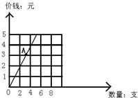

# Mathematics (Grade 6)

**ID**: 30de1490
**难度**: hard
**题型**: fill_in_the_blank

## 题目
周老师买圆珠笔的钱数与数量如图．
（1）图中A点表示周老师买$\underline{\hspace{5em}}$支笔用了$\underline{\hspace{5em}}$元．
（2）图中的这条直线表示$\underline{\hspace{5em}}$和$\underline{\hspace{5em}}$成$\underline{\hspace{5em}}$比例．

## 解答

**答案**: 3, 3, 圆珠笔的钱数, 数量, 正

1. Step1:观察图像找到A点，其横坐标对应笔的数量，为3支
2. Step2:观察图像找到A点，其纵坐标对应花的钱数，为3元
3. Step3:计算不同数量笔对应的钱数的比值，如2÷2 = 1，3÷3 = 1，可知圆珠笔的钱数÷数量 = 圆珠笔的单价（一定）
4. Step4:根据正比例关系的定义，当两个量的比值一定时，这两个量成正比例关系，所以圆珠笔的钱数和数量成正比例

## 知识点

**知识点**:
  - 辨识成正比例的量与成反比例的量．

---
