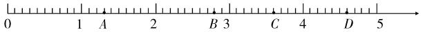

# Mathematics (Grade 6)

**ID**: 315ac277
**难度**: hard
**题型**: fill_in_the_blank

## 题目
看图填一填。

1.A=（），B=（），C=（），D=（）。
2.A、B、C、D中最接近1.95的数是（）。
3.比B多0.5的数是（）。
4.A比（）少4.4。

## 解答

**答案**: 1.3, 2.8, 3.6, 4.6, A, 3.3, 5.7

1. Step1:根据数轴上的刻度，A过了1且过了3小格，所以A = 1.3
2. Step2:B过了2且过了8小格，所以B = 2.8
3. Step3:C过了3且过了6小格，所以C = 3.6
4. Step4:D过了4且过了6小格，所以D = 4.6
5. Step5:在数轴上找出1.95，比较1.3、2.8、3.6、4.6与1.95的距离，可得最接近1.95的数是A
6. Step6:已知B = 2.8，计算比B多0.5的数，2.8 + 0.5 = 3.3
7. Step7:已知A = 1.3，计算A比哪个数少4.4，1.3 + 4.4 = 5.7

## 知识点

**知识点**:
  - 小数的加法和减法

---
