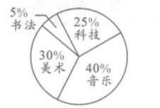

# Mathematics (Grade 6)

**ID**: 3275e776
**难度**: hard
**题型**: fill_in_the_blank

## 题目
实验小学五年级有80名同学参加了课外活动小组。

1.上面的统计图叫（）。
2.通过观察统计图，我知道：
参加（）小组的人最多，
参加（）小组的人最少。
3.参加美术小组的有（）人，参加书法小组的有（）人。

## 解答

**答案**: 扇形统计图, 音乐, 书法, 24, 4

1. Step1:根据扇形统计图的特征，可知该统计图是用整个圆表示总数，用圆内各个扇形的大小表示各部分数量占总数的百分数，所以上面的统计图叫扇形统计图
2. Step2:观察统计图中各扇形所占比例，音乐小组占40%，比例最大，书法小组占5%，比例最小，所以参加音乐小组的人最多，参加书法小组的人最少
3. Step3:已知总人数为80人，美术小组占30%，则参加美术小组的人数为80×30%=24人
4. Step4:已知总人数为80人，书法小组占5%，则参加书法小组的人数为80×5%=4人

## 知识点

**知识点**:
  - 扇形统计图

---
