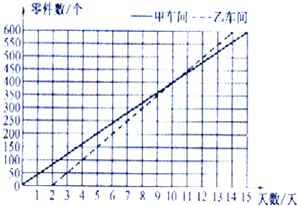

# Mathematics (Grade 6)

**ID**: 34a9a8fb
**难度**: hard
**题型**: fill_in_the_blank

## 题目
如图是某厂甲、乙两个车间各生产600个零件过程中，生产零件的个数与生产时间的关系图：
（1）从图上可以看出两个车间生产零件的个数分别与它们所用的时间成$\underline{\hspace{5em}}$比例．
（2）乙车间生产$\underline{\hspace{5em}}$天后赶上甲车间生产的个数，甲、乙两个车间完成任务时，$\underline{\hspace{5em}}$车间所用的时间多
（3）当乙完成任务时，甲还有$\underline{\hspace{5em}}$个没做，$\underline{\hspace{5em}}$车间工作效率高，高$\underline{\hspace{5em}}$%．

## 解答

**答案**: 正, 9, 甲, 50, 乙, 25

1. Step1:判断两个车间生产零件个数与所用时间的关系，根据正比例的判断方法，即看两种量是否为对应的比值一定，由于从图中可看出是比值一定，所以两个车间生产零件的个数分别与它们所用的时间成正比例
2. Step2:观察图像，找出乙车间赶上甲车间生产个数时对应的天数，可得乙车间生产9天后赶上甲车间生产的个数；再比较甲、乙两个车间完成任务时所用的时间，可知甲车间所用的时间多
3. Step3:计算甲、乙的工作效率，甲的工作效率为600÷15 = 40（个），乙的工作效率为600÷12 = 50（个），当乙完成任务时，甲工作了12天，生产了40×12 = 480个，那么甲还有600 - 480 = 120个没做；比较甲、乙工作效率，可知乙车间工作效率高
4. Step4:计算乙车间比甲车间工作效率高的百分比，即(50 - 40)÷40×100% = 25%

## 知识点

**知识点**:
  - 正比例和反比例的意义．

---
