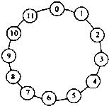

# Mathematics (Grade 6)

**ID**: 3b2b3b21
**难度**: hard
**题型**: fill_in_the_blank

## 题目
如图：电子跳蚤每跳一步，可从一个圆圈跳到相邻的圆圈．现在，一只红跳蚤从标有数字“0”的圆圈按顺时针方向跳了2013步，落在一个圆圈里．一只黑跳蚤也从标有数字“0”的圆圈起跳，但它是沿着逆时针方向跳了2012步，落在另一个圆圈里．那么这两个圆圈里数字的乘积是$\underline{\hspace{5em}}$．

## 解答

**答案**: 36

1. Step1:明确这是一个关于周期循环的问题，12个数0，1，2，3，4，…，11为一个循环周期
2. Step2:计算红跳蚤按顺时针方向跳的情况，2013÷12=167…9，根据循环规律，余数为9时对应的圆圈数字是9
3. Step3:计算黑跳蚤按逆时针方向跳的情况，2012÷12=167…8，根据循环规律，余数为8时对应的圆圈数字是4
4. Step4:计算两个圆圈数字的乘积，9×4=36

## 知识点

**知识点**:
  - 哈密尔顿圈与哈密尔顿链．

---
