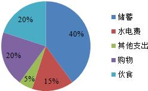

# Mathematics (Grade 6)

**ID**: 3c19d9e5
**难度**: hard
**题型**: fill_in_the_blank

## 题目
小明家今年5月份支出及储蓄情况如图．
（1）小明家5月份的伙食费共花了1000元，小明家的支出及储蓄总共是$\underline{\hspace{5em}}$元．
（2）小明的妈妈5月28日到银行存了$\underline{\hspace{5em}}$元，年利息是1.98%，明年到期利息是$\underline{\hspace{5em}}$元．

## 解答

**答案**: 5000, 2000, 39.6

1. Step1:明确小明家的总支出和储蓄是单位‘1’，已知伙食费1000元占单位‘1’的20%，因为单位‘1’未知，所以用除法计算总支出和储蓄，即1000÷20%=5000元
2. Step2:已知储蓄占总支出和储蓄（单位‘1’）的40%，用乘法计算储蓄的钱数，即5000×40%=2000元
3. Step3:根据利息=本金×利率×时间，本金为2000元，利率是1.98%，时间是1年，计算明年到期利息，即2000×1.98%×1=39.6元

## 知识点

**知识点**:
  - 扇形统计图；存款利息与纳税相关问题；从统计图表中获取信息．

---
