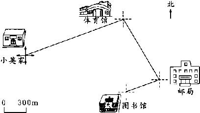

# Mathematics (Grade 6)

**ID**: 3c8eb889
**难度**: hard
**题型**: fill_in_the_blank

## 题目
（1）根据下面的路线图，量一量，算一算，再在下面的表格里填写小英去体育馆、邮局和图书馆所走的方向及路程．

$\begin{array}{|c|c|c|c|}
\hline
 & 方向 & 路程 & 时间 \\ \hline
小英家→体育馆 &  &  & 6分 \\ \hline
体育馆→邮局 &  &  & 4分 \\ \hline
邮局→图书馆 &  &  & 2分 \\ \hline
\end{array}$（2）求出小英从家到图书馆全程的平均速度．

## 解答

**答案**: 东北, 24米, 6分, 东南, 16.5, 4分, 西南, 7.5, 2分, 4（米/分）

1. Step1:量出小英家→体育馆的图上距离约8厘米，根据比例尺1:300，计算实际距离为8÷$\frac{1}{300}$=2400厘米=24米，确定方向为东北，时间为6分
2. Step2:量出体育馆→邮局的图上距离约5.5厘米，根据比例尺计算实际距离为5.5÷$\frac{1}{300}$=1650厘米=16.5米，确定方向为东南，时间为4分
3. Step3:量出邮局→图书馆的图上距离约2.5厘米，根据比例尺计算实际距离为2.5÷$\frac{1}{300}$=750厘米=7.5米，确定方向为西南，时间为2分
4. Step4:计算从家到图书馆的总路程为24 + 16.5 + 7.5 = 48米，总时间为6 + 4 + 2 = 12分
5. Step5:用总路程除以总时间得到平均速度为48÷12 = 4米/分
6. Step6:整理结果为['东北', '24米', '6分', '东南', '16.5', '4分', '西南', '7.5', '2分', '4（米/分）']

## 知识点

**知识点**:
  - 简单的行程问题．

---
