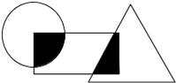

# Mathematics (Grade 6)

**ID**: 404e11fc
**难度**: hard
**题型**: fill_in_the_blank

## 题目
圆形中的阴影部分占圆面积的$\frac{1}{6}$，占正方形面积的$\frac{1}{5}$，三角形中阴影部分面积占三角形面积的$\frac{1}{9}$，占正方形面积的$\frac{1}{4}$，圆、正方形、三角形的最简整数比是 $\underline{\hspace{5em}}$ ．

## 解答

**答案**: 12, 10, 27

1. Step1:把圆的面积看作单位'1'。
2. Step2:根据圆形中阴影部分占圆面积的$rac{1}{6}$，占正方形面积的$rac{1}{5}$，计算正方形面积是圆面积的$rac{1}{6}÷rac{1}{5}=rac{5}{6}$。
3. Step3:根据三角形中阴影部分面积占三角形面积的$rac{1}{9}$，占正方形面积的$rac{1}{4}$，计算三角形面积是圆面积的$rac{1}{4}÷rac{1}{9}=rac{9}{4}$。
4. Step4:写出圆、正方形、三角形面积比为1：$rac{5}{6}$：$rac{9}{4}$。
5. Step5:将1：$rac{5}{6}$：$rac{9}{4}$各项同乘12进行化简，得到12：10：27。

## 知识点

**知识点**:
  - 重叠问题;比的意义

---
