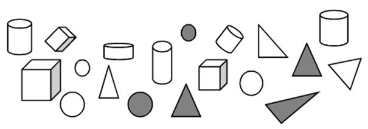

# Mathematics (Grade 6)

**ID**: 41cd9ebc
**难度**: hard
**题型**: fill_in_the_blank

## 题目
根据图形填一填．

把分类的结果整理在表中．
(1)
$\begin{array}{|c|c|c|}
\hline
 & 灰色
 & 白色
 \\\hline
个数
 &  
 &  
 \\\hline
\end{array}$
(2)
$\begin{array}{|c|c|c|c|c|}
\hline
 & 圆柱
 & 正方体
 & 圆形
 & 三角形
 \\\hline
个数
 &  
 &  
 &  
 &  
 \\\hline
\end{array}$
根据上面表格分类的结果，回答一下问题
（ ）的个数最多，（ ）的个数最少，
（ ）的个数和（ ）的个数同样多，
（ ）的个数比（ ）的个数多3个

## 解答

**答案**: 三角形, 正方体, 圆柱, 圆形, 三角形, 正方体

1. Step1:数出图中灰色图形的个数为5
2. Step2:数出图中白色图形的个数为14
3. Step3:数出图中圆柱的个数为5
4. Step4:数出图中正方体的个数为3
5. Step5:数出图中圆形的个数为5
6. Step6:数出图中三角形的个数为6
7. Step7:比较各类图形个数，得出个数最多的是三角形
8. Step8:比较各类图形个数，得出个数最少的是正方体
9. Step9:比较各类图形个数，得出圆柱和圆形的个数同样多
10. Step10:比较各类图形个数，得出三角形的个数比正方体的个数多3个

## 知识点

**知识点**:
  - 小学数学;图形与几何;平面图形;平面图形的认识及分类;立体图形;立体图形的认识及分类

---
